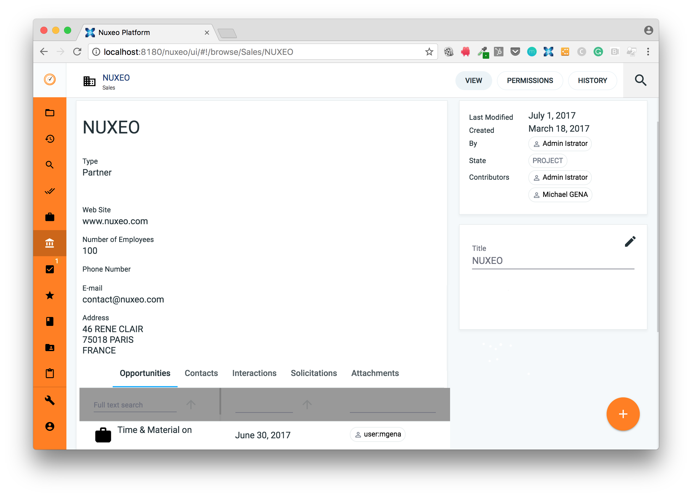

[](https://travis-ci.org/qualitified/qualitified-crm)
# qualitified-crm



This plugin adds all the necessary features for your nuxeo instance to become a CRM (Customer Relationship Management) solution.
It provides everything to handle Accounts, Opportunities, Contacts, Interactions etc.
The User Interface is based on Web UI.
In addition of handling your customer base in nuxeo you will also benefit of the document management capability. This brings you a platform that is capable to handle both your customers and their related documents (Contracts, Specifications, Invoices etc.) but also media files (Video, Picture, Audio).
You will have everything in one place, giving you a 360 view of everything related to your customers.

# Building
Assuming Apache Maven 3.8+, JDK 21 and git are installed on your computer:
```
  cd /PATH/TO/YOUR/MAIN/FOLDER
  git clone https://github.com/qualitified/qualitified-crm.git
  cd qualitified-crm
  mvn clean install
```
The Package to install on your nuxeo server is in qualitified-crm-package/target/qualitified-crm-package-6.10.zip

# Installation
First you need to download Nuxeo LTS 2025.9 (2025.9.26) from https://doc.nuxeo.com/nxdoc/nuxeo-server-release-notes-2025-9/

Then start your nuxeo instance:
```
  cd /PATH/TO/YOUR/NUXEO/INSTANCE/
  cd bin
  nuxeoctl start
```
Then make the initial configuration by going through the url: http://localhost:8080/nuxeo

Then stop your nuxeo instance and install the qualitified-crm package:
```
  nuxeoctl stop
  nuxeoctl mp-install --nodeps PATH/TO/YOUR/MAIN/FOLDER/qualitified-crm/qualitified-crm-package/target/qualitified-crm-package-6.10.zip
```
Then start your nuxeo instance:
```
  nuxeoctl start
```
If everything went well, you will end up with the CRM plugin deployed on your nuxeo instance.

# Support

These features are part of an ongoing project. If you need a supported version please contact me directly on @michael_gena

# Licensing

Apache License, Version 2.0

# About Qualitified

At Qualitified we provide packages on top of nuxeo, in order to bring additional behaviors to the platform. We also do consultings on nuxeo projects by bringing our expertise on multiple levels (Data Models, Business Rules, Workflows, UI based on Polymer etc.)
